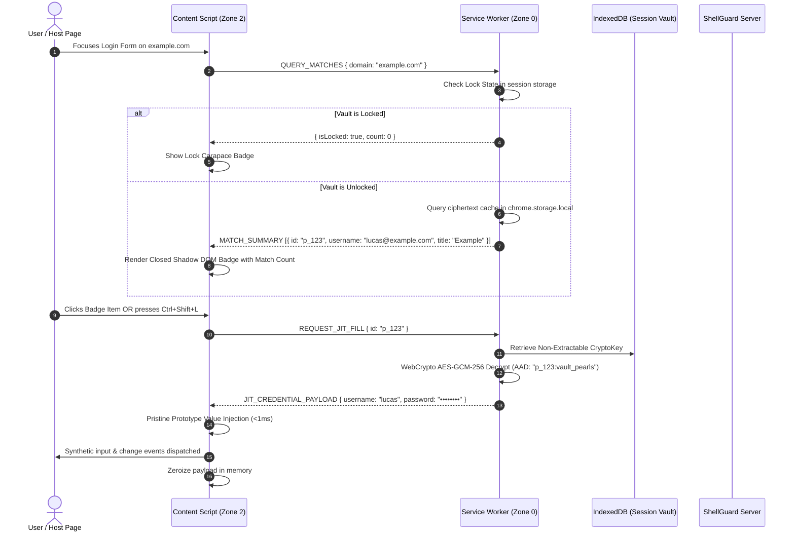

# 🏗️ System Architecture: ShellGuard-Extension

[](#)
[](#)
[](#)
[](#)

> Authoritative structural and technical specification for **ShellGuard-Extension v0.0.1.0** — zero-knowledge Chromium browser extension (Manifest V3) for client-decrypted autofill, micro-TOTP generation, and agentic vault delegation.

---

## 📖 Table of Contents

- [1. Executive Architectural Blueprint](#1-executive-architectural-blueprint)
- [2. Three-Zone Security Boundary](#2-three-zone-security-boundary)
- [3. Complete Directory Structure](#3-complete-directory-structure)
- [4. Data Flow & Inter-Context Communication](#4-data-flow--inter-context-communication)
- [5. Component Architecture & Responsibilities](#5-component-architecture--responsibilities)
- [6. Autofill & Anti-Pollution Mechanics](#6-autofill--anti-pollution-mechanics)
- [7. Micro-TOTP Engine Architecture](#7-micro-totp-engine-architecture)
- [8. Agentic Delegation (`lb-` LobsterKeys)](#8-agentic-delegation-lb--lobsterkeys)
- [9. Network Mobility & Cleartext LAN Carve-Out](#9-network-mobility--cleartext-lan-carve-out)
- [10. Cloud CI & Verification Strategy](#10-cloud-ci--verification-strategy)

---

## 1. Executive Architectural Blueprint

ShellGuard-Extension operates as the browser execution gateway of the self-hosted [ShellGuard](https://github.com/ClawStackStudios/ShellGuard) ecosystem. It eliminates centralized cloud trust by performing all cryptographic derivation, zero-knowledge decryption, and credential injection locally inside the client's Chromium runtime.

### High-Level Topology:
```mermaid
graph TB
    subgraph Browser["Chromium Browser Runtime (MV3)"]
        subgraph Zone2["Zone 2: Untrusted DOM (Content Scripts)"]
            Observer["Form & Input Observer"]
            ShadowUI["Closed Shadow Root UI (`attachShadow({ mode: 'closed' })`)"]
            PristineSetter["Pristine Prototype Value Injector"]
        end

        subgraph Zone1["Zone 1: Extension Presentation (React SPAs)"]
            Popup["Popup UI (`entrypoints/popup/`)"]
            SidePanel["Side Panel UI (`entrypoints/sidepanel/`)"]
            Options["Settings Hub (`entrypoints/options/`)"]
        end

        subgraph Zone0["Zone 0: Secure Cryptographic Enclave"]
            SW["Background Service Worker (`entrypoints/background.ts`)"]
            Offscreen["Offscreen Crypto Engine (`entrypoints/offscreen/`)"]
            IDB["IndexedDB StructuredClone (`ShellGuardSessionVault`)"]
            Session["chrome.storage.session (RAM Only)"]
            Disk["chrome.storage.local (Ciphertext Only)"]
        end
    end

    subgraph Host["Self-Hosted ShellGuard Server"]
        SyncAPI["REST API (/api/sync, /api/vault)"]
        AuditLog["Append-Only Audit (audit.sqlite)"]
    end

    Observer -->|Zod Message: Query Matches| SW
    SW <-->|Store/Retrieve Non-Extractable CryptoKey| IDB
    SW <-->|Store/Retrieve Session State & Nonce| Session
    SW <-->|Cache Encrypted Ciphertext Blobs| Disk
    SW <-->|Heavy Crypto & Fallbacks| Offscreen
    SW <-->|HTTPS / LAN HTTP Sync| SyncAPI
    SW -->|JIT Decrypted Secret (1ms)| PristineSetter
    PristineSetter -->|Dispatch Input/Change| Observer
    ShadowUI -.->|Visually Mounted, DOM-Isolated| Observer
    Popup & SidePanel <-->|Zod Messaging| SW
```

---

## 2. Three-Zone Security Boundary

To adhere to the foundational axiom — *"Build features around security, never security around features"* — the extension is partitioned into three strictly segregated security zones:

| Zone | Boundary Target | Privilege & Memory Model | Cryptographic Capability |
| :--- | :--- | :--- | :--- |
| **Zone 0** | Background Service Worker & Offscreen Enclave | Ephemeral worker, in-memory `chrome.storage.session`, non-extractable IndexedDB handles. | Holds `CryptoKey` handles; executes HKDF-SHA256, AES-GCM-256 with AAD binding. |
| **Zone 1** | Popup, Side Panel, Options Hub | React 18 SPA, Sandboxed extension origin (`chrome-extension://`). | Renders decrypted items while active; zeroizes immediately on close/lock. |
| **Zone 2** | Content Scripts on Target Web Pages | Untrusted webpage execution world, shared DOM scope. | **Zero crypto capability.** Stateless. Receives JIT credential for <1ms during fill, then zeroizes. |

---

## 3. Complete Directory Structure

The project uses **WXT (Web Extension Tools)** with TypeScript, React 18, and Tailwind CSS:

```text
ShellGuard-Extension/
├── 📄 AGENTS.md                          # Ultra-compressed invariant project law & cartography
├── 📄 ARCHITECTURE.md                    # This authoritative architectural specification
├── 📄 SECURITY.md                        # Threat model, attack scenarios, and invariant gates
├── 📄 README.md                          # Repository overview and ecosystem mapping
├── 📄 CHANGELOG.md                       # Keep a Changelog 1.1.0 version chronicle
├── 📄 DESIGN.md                          # Reef Modernist UI token & layout specification
├── 📄 package.json                       # Dependencies & build scripts (WXT, React 18, Tailwind)
├── 📄 tsconfig.json                      # Strict TypeScript compiler options
├── 📄 wxt.config.ts                      # WXT Manifest V3 bundler configuration
├── 📄 tailwind.config.ts                 # Reef Modernist color tokens and theme scales
├── 📄 .gitignore                         # Build artifact and secret exclusion filters
│
├── ⚙️ .agents/                           # Agentic Governance & Instruction Layer
│   ├── rules/
│   │   ├── extension-security-invariants.md # Invariant DOM boundaries, JIT rules, key quarantine
│   │   └── git-hygiene.md               # Two-layer conventional commits, branch isolation
│   └── skills/
│       └── zero-knowledge-crypto/       # WebCrypto HKDF, AAD, and IndexedDB recipes
│           └── SKILL.md
│
├── 📂 assets/                            # Raw branding, SVGs, and feature graphics
│   ├── icons/
│   │   ├── icon-16.png                  # Chrome toolbar icon (16x16)
│   │   ├── icon-48.png                  # Extension manager icon (48x48)
│   │   ├── icon-128.png                 # Web Store icon (128x128)
│   │   └── shellguard-shell.svg         # Pristine vector logo
│   └── feature-graphic.png              # Store promo graphic (1400x560)
│
├── 📂 entrypoints/                       # WXT Manifest V3 Auto-Discovered Entrypoints
│   ├── background.ts                    # MV3 Service Worker (alarms, lifecycle, message router)
│   ├── offscreen/                       # Offscreen Document (persistent WebCrypto execution)
│   │   ├── index.html
│   │   └── main.ts
│   ├── content.tsx                      # Content Script (Form observer & Closed Shadow DOM UI)
│   ├── popup/                           # Primary Extension Popup SPA (400x600 viewport)
│   │   ├── index.html
│   │   ├── main.tsx
│   │   └── App.tsx
│   ├── sidepanel/                       # Side Panel Companion SPA (persistent drawer)
│   │   ├── index.html
│   │   ├── main.tsx
│   │   └── App.tsx
│   └── options/                         # Settings, Server Config & SuperLobster Admin Hub
│       ├── index.html
│       ├── main.tsx
│       └── App.tsx
│
├── 📂 src/                              # Core Source Architecture
│   ├── crypto/                          # Zero-Knowledge Cryptographic Core
│   │   ├── hkdf.ts                      # HKDF-SHA256 key derivation across 10 namespaces
│   │   ├── aesGcm.ts                    # AES-GCM-256 with strict AAD binding (uuid:namespace)
│   │   ├── sessionVault.ts              # IndexedDB StructuredClone non-extractable key quarantine
│   │   ├── webCryptoFallback.ts         # Byte-for-byte pure-TS fallback for HTTP LAN contexts
│   │   └── zeroizer.ts                  # Memory sanitization & array buffer scrubbing
│   │
│   ├── services/                        # Service & Engine Layer
│   │   ├── api/                         # REST Client for ShellGuard Server
│   │   │   ├── client.ts                # Fetch client supporting HTTPS & HTTP LAN
│   │   │   └── syncAdapter.ts           # Delta synchronization engine
│   │   ├── matcher/                     # Bitwarden-Parity URI Matcher
│   │   │   ├── uriMatcher.ts            # 6-mode matcher (Base Domain/eTLD+1, Host, Exact, etc.)
│   │   │   └── domainParser.ts          # Public Suffix List domain normalization
│   │   ├── totp/                        # Dynamic Authenticator Engine
│   │   │   ├── totpEngine.ts            # RFC 6238 HMAC-SHA1/256/512 calculation
│   │   │   └── otpParser.ts             # `otpauth://` URI decomposition
│   │   ├── generator/                   # Entropy & Credential Generator
│   │   │   ├── passwordGenerator.ts     # Character-class entropy builder
│   │   │   └── dicewareGenerator.ts     # Multi-word passphrase generator
│   │   └── storage/                     # Storage Abstraction Layer
│   │       ├── sessionStorage.ts        # chrome.storage.session wrapper
│   │       └── localStorage.ts          # chrome.storage.local ciphertext cache
│   │
│   ├── content/                         # Content Script Subsystem
│   │   ├── detector/                    # Form & Input Field Heuristics
│   │   │   ├── formObserver.ts          # MutationObserver for dynamic SPAs
│   │   │   └── fieldClassifier.ts       # Co-presence gate (username + password pairing)
│   │   ├── overlay/                     # Closed Shadow DOM UI
│   │   │   ├── CarapaceOverlay.tsx      # In-page badge & credential picker component
│   │   │   └── positionAnchor.ts        # Relative coordinate anchoring
│   │   └── injector/                    # Pristine Prototype DOM Mutator
│   │       └── nativeSetter.ts          # HTMLInputElement.prototype.value setter + synthetic events
│   │
│   ├── components/                      # Shared Reef Modernist React Components
│   │   ├── ui/                          # Carapace Primitives (Card, Button, Input, Modal)
│   │   ├── vault/                       # Vault Item Cards, Pod Filters, Details Pane
│   │   ├── generator/                   # Generator Slider, Word Count, History Drawer
│   │   └── layout/                      # Header, Navigation Tabs, Amber Warning Pill
│   │
│   └── types/                           # Strict Zod Schemas & TypeScript Definitions
│       ├── envelopes.ts                 # Message envelopes `{ id, type, payload, timestamp }`
│       ├── vault.ts                     # Pearl, Note, Card, SSH Key, Identity models
│       └── server.ts                    # Wire contracts matching ShellGuard Server
│
├── 📂 tests/                            # Unit & Integration Oracles (Offloaded to Cloud CI)
│   ├── crypto/                          # Cryptographic test vectors & tamper rejection
│   ├── matcher/                         # URI matching test suites
│   ├── totp/                            # RFC 6238 published test vectors
│   └── messaging/                       # Zod schema boundary validation
│
└── 📂 scripts/                          # Fast Local Pre-Flight & Build Tooling
    └── audit_docs_drift.py              # Sub-second SSoT documentation drift detection
```

---

## 4. Data Flow & Inter-Context Communication

All communication between extension contexts is envelope-wrapped and runtime-validated through Zod schemas.

```
┌─────────────────────────────────────────────────────────────────────────────┐
│                       ZOD MESSAGE ENVELOPE FORMAT                           │
│                                                                             │
│   {                                                                         │
│     "id": "msg_01h8x4j9b3",                                                 │
│     "type": "QUERY_CREDENTIALS" | "REQUEST_AUTOFILL" | "VAULT_LOCK",        │
│     "payload": { ... },                                                     │
│     "timestamp": 1729252800000                                              │
│   }                                                                         │
└─────────────────────────────────────────────────────────────────────────────┘
```

### Autofill Execution Lifecycle:


---

## 5. Component Architecture & Responsibilities

### 5.1 Service Worker (`entrypoints/background.ts`)
- Manages browser command shortcuts (`Ctrl+Shift+L` / `Cmd+Shift+L`).
- Handles scheduled periodic alarms (vault idle lock timeout, background delta sync).
- Acts as the central Zod message router between popups, side panels, and content scripts.
- Never accesses the webpage DOM; operates strictly in background service context.

### 5.2 Offscreen Document (`entrypoints/offscreen/`)
- Created on-demand via `chrome.offscreen.createDocument`.
- Hosts WebCrypto primitives requiring DOM-adjacent environments, pure-TS cryptographic fallback processing, or heavy clipboard parsing.
- Ensures cryptographic operations complete reliably even if the service worker encounters an idle termination notice.

### 5.3 In-Page Content Script (`entrypoints/content.tsx`)
- Detects username, email, and password input fields using MutationObservers.
- Mounts the `CarapaceOverlay` UI into a closed Shadow DOM root (`attachShadow({ mode: 'closed' })`).
- Binds to active frame coordinates, repositioning dynamically during viewport scrolling and window resizing.
- Stateless: Holds zero passwords, zero master keys, and zero decrypted vault state.

### 5.4 Popup & Side Panel SPAs (`entrypoints/popup/`, `entrypoints/sidepanel/`)
- Unified React 18 frontend adhering strictly to **Reef Modernist** styling.
- Features:
  - **Vault Browser**: Pod filter hierarchy, instant search across decrypted items.
  - **Generator Suite**: High-entropy password and passphrase generation with password history.
  - **Micro-TOTP Ring**: Circular SVG countdown timer with click-to-copy action.
  - **Server Telemetry Pill**: Displays connection status, last sync timestamp, and amber LAN warning pill if connected via cleartext HTTP.

---

## 6. Autofill & Anti-Pollution Mechanics

### 6.1 Co-Presence Detection Gate
To prevent false-positive badges on search bars, newsletter subscription forms, and generic inputs, the content script applies a strict **Co-Presence Gate**:
1. Scan for `input[type="password"]`.
2. Traverse ancestor `<form>` or surrounding container element (up to 4 DOM levels).
3. If a password field is detected:
   - Identify candidate username/email inputs (`type="text"`, `type="email"`, `autocomplete="username"`).
   - Anchor the ShellGuard carapace icon within the active fields.
4. If no password field is present in the container:
   - Suppress autofill chips unless the target URL matches a high-confidence single-identifier domain (e.g., Google or Microsoft multi-step sign-in).

### 6.2 Anti-Pollution Prototype Execution
Websites can deliberately or inadvertently pollute `window.HTMLInputElement.prototype` or define rogue getters/setters on `Object.prototype`. Direct assignment `input.value = secret` can be intercepted or fail silently.

The extension executes input population using the pristine prototype descriptor retrieved in the isolated world:
```typescript
export function injectCredentialSafely(element: HTMLInputElement, value: string): void {
  const descriptor = Object.getOwnPropertyDescriptor(window.HTMLInputElement.prototype, 'value');
  const nativeSetter = descriptor?.set;

  if (nativeSetter) {
    nativeSetter.call(element, value);
  } else {
    element.value = value;
  }

  // Dispatch synthetic trusted events so frameworks (React, Vue, Angular) register the update
  element.dispatchEvent(new Event('input', { bubbles: true, cancelable: true }));
  element.dispatchEvent(new Event('change', { bubbles: true, cancelable: true }));
}
```

---

## 7. Micro-TOTP Engine Architecture

ShellGuard-Extension includes an integrated RFC 6238 TOTP engine providing instant 2FA code generation:

- **Algorithms Supported:** HMAC-SHA1, HMAC-SHA256, HMAC-SHA512.
- **Periods:** Configurable (15s, 30s, 60s); default 30s.
- **Digits:** 6 or 8 digits with zero-padded formatting.
- **Automatic Copy on Autofill:** When configured in user settings, autofilling a login credential automatically copies the matching TOTP code to the clipboard and starts a 30s clipboard purge countdown.
- **Visual Pulse Ring:** An animated SVG circular progress ring indicating remaining validity seconds, rendered in **Claw Cyan (`#06B6D4`)**, transitioning to **Coral Amber (`#D29922`)** at $\le 5$ seconds.

---

## 8. Agentic Delegation (`lb-` LobsterKeys)

In addition to standard human user logins (`hu-`), ShellGuard-Extension supports autonomous AI agents operating under scoped **LobsterKeys (`lb-`)**:

- **Structural Permissions:** Agents possess granular permissions: `canRead`, `canWrite`, `canEdit`, `canDelete`.
- **Domain Whitelisting:** Agents can be scoped to specific domains or pods (e.g., `development`, `staging`), preventing access to personal or banking pods.
- **Autonomous Autofill API:** Extension exposes an internal agent port allowing authorized local sub-agents to trigger credential retrieval for automated browser workflows without human manual intervention, while logging every access to the server's `audit.sqlite`.

---

## 9. Network Mobility & Cleartext LAN Carve-Out

Self-hosters frequently deploy ShellGuard instances on local homelab servers (Unraid, TrueNAS, Proxmox) without public TLS domains. 

- **LAN Carve-Out:** Cleartext HTTP is allowed strictly for private RFC 1918 addresses (`10.0.0.0/8`, `172.16.0.0/12`, `192.168.0.0/16`), `localhost`, and internal `.local` / Tailscale CGNAT IP ranges (`100.64.0.0/10`).
- **Amber Warning Pill:** Any connection to a cleartext HTTP endpoint mandates displaying a prominent amber warning pill in the UI:
  ```text
  ⚠️ HTTP LAN (Unencrypted Transport — Homelab Only)
  ```
- **WAN Prohibition:** Cleartext HTTP on public WAN domains is structurally blocked and throws a hard transport error.

---

## 10. Cloud CI & Verification Strategy

Adhering to **Rule 5 (Host Preservation & Cloud CI Gate)**:
- **Local Workstation:** Executes only instantaneous documentation drift audits (`python3 scripts/audit_docs_drift.py`), static linting (`npm run lint`), and typecheck (`npm run typecheck`).
- **Cloud Verification Runner:** GitHub Actions (`.github/workflows/ci.yml`) executes the full matrix:
  - Unit test suite (WebCrypto test vectors, AAD tamper tests, URI matcher).
  - Production extension packaging via `wxt zip`.
  - Manifest V3 policy linting.
  - Test coverage reports.
