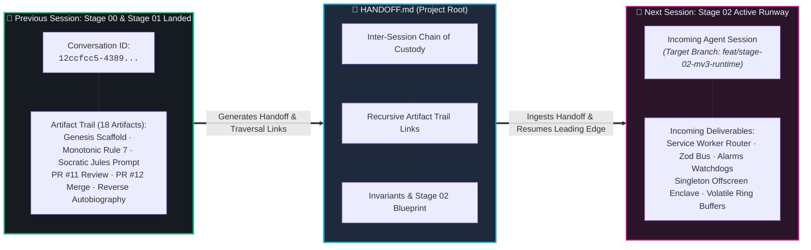

# 🦞 ShellGuard-Extension Session Handoff: Stage 01 ➔ Stage 02

> **Canonical Document**: Root `HANDOFF.md`  
> **Protocol**: Antigravity Inter-Session Chain of Custody & Recursive Artifact Trail  
> **Current Shipped Milestone**: `v0.0.0.2 (Build 2)` — Cryptographic Bedrock & Session Quarantine (Stage 01 Landed ✅)  
> **Incoming Milestone Target**: `v0.0.0.3 (Build 3)` — MV3 Runtime & Offscreen Enclave Router (Stage 02 🚀)  
> **Handoff Author**: Lucas (@lucas) & Antigravity (@antigravity)  
> **Timestamp**: 2026-10-24 16:00 PST  
> **Conversation ID**: `12ccfcc5-4389-42fa-b2a2-682667998380`

---

## 🏛️ Executive Summary & Immediate Status

ShellGuard-Extension has successfully landed and verified **Stage 00 (Genesis Scaffold, `v0.0.0.1 Build 1`)** and **Stage 01 (Cryptographic Bedrock & Session Quarantine, `v0.0.0.2 Build 2`)**.

The cryptographic core of the zero-knowledge carapace is mathematically complete and tested:
1. **WebCrypto HKDF-SHA256 Derivation:** Master PRK derivation salted with `userUuid`; expansion into 10 independent domain keys (`vault_pearls` through `export`) enforced with `extractable: false`.
2. **AES-GCM-256 with AAD Record Binding:** 96-bit CSPRNG IVs, 128-bit authentication tags, and strict Additional Authenticated Data binding ($\text{AAD} = \text{recordUuid} \parallel \text{":"} \parallel \text{namespace} \parallel (\text{":"} \parallel \text{podId})$). Mutating a single bit of ciphertext, IV, or AAD throws a terminal `OperationError`.
3. **Session Vault Persistence (`ShellGuardSessionVault`):** Native IndexedDB structured clone storage preserving non-extractable `CryptoKey` handles across MV3 service worker suspensions without disk secret leakage.
4. **Pure-TS Fallback (`@noble/hashes` & `@noble/ciphers`):** Full cryptographic fallback for RFC 1918 / Tailscale LAN HTTP where `crypto.subtle` is blocked, verified via bidirectional cross-decryption test suites.
5. **Memory Zeroization:** Zero-fill scrubbing with `zeroizeBytes` and `zeroizeBuffer` aliases.
6. **Monotonic Cascading Versioning (Rule 7):** Target version `v0.0.0.2` (Build 2) synchronized across `package.json`, `wxt.config.ts`, `tests/genesis.test.ts`, and `ROADMAP.md`.

The repository stands in a pristine, verified state:
- **`main` Branch**: Clean, up to date with `origin/main` at commit `2613de6`.
- **Cloud CI**: 100% green on GitHub Actions across both `pre-flight` and `test-and-package` jobs (16/16 Vitest tests passing, 0 ESLint warnings, 0 TypeScript errors).
- **Sub-Second Static Gate**: `npm run lint && npm run typecheck && python3 scripts/audit_docs_drift.py` passes with exit code 0.
- **Active Leading Edge**: Advanced to **Stage 02 — MV3 Runtime & Offscreen Enclave Router (`v0.0.0.3` • Build 3)**.

---

## 🧭 Repository Coordinates & Active State

| Coordinate | Value / Target | Notes |
| :--- | :--- | :--- |
| **Active Branch** | `main` | Clean, synchronized with `origin/main` at `2613de6` |
| **Target Version** | `v0.0.0.2 (Build 2)` | Cryptographic Bedrock & Session Quarantine Landed |
| **Next Version** | `v0.0.0.3 (Build 3)` | MV3 Runtime & Offscreen Enclave Router |
| **Next Stage Directory** | `.agents/skills/project/stages/stage-02-mv3-runtime/prompt.md` | Read before cutting code |
| **Bound Oracles for Stage 02** | `specs/network/wire-contracts.md`, `specs/crypto/key-hierarchy.md` | Core laws for router and offscreen enclave |
| **Local Verification** | `npm run lint && npm run typecheck && python3 scripts/audit_docs_drift.py` | Sub-second mandatory local gate |
| **Cloud CI** | `.github/workflows/ci.yml` | Offloads heavy packaging (`wxt build`, `wxt zip`) to GitHub Actions |

---

## 🗂️ Complete SSoT Artifact Directory Map

All artifacts are persisted in the Antigravity Brain directory (`/config/.gemini/antigravity/brain/12ccfcc5-4389-42fa-b2a2-682667998380/`):

1. **[17-meta-phase-1-stages-00-01-autobiography.md](file:///config/.gemini/antigravity/brain/12ccfcc5-4389-42fa-b2a2-682667998380/17-meta-phase-1-stages-00-01-autobiography.md):** The comprehensive reverse-chronological autobiography of the hand across Stages 00 and 01.
2. **[pr_review_12_2026_10_24_2120.md](file:///config/.gemini/antigravity/brain/12ccfcc5-4389-42fa-b2a2-682667998380/pr_review_12_2026_10_24_2120.md):** Evidence-backed PR review artifact for PR #12 confirming the `0.0.0.2` version bump, bidirectional tests, and final `MERGE` verdict.
3. **[pr_review_11_2026_10_24_1930.md](file:///config/.gemini/antigravity/brain/12ccfcc5-4389-42fa-b2a2-682667998380/pr_review_11_2026_10_24_1930.md):** Initial evidence-backed PR review for PR #11 with `MERGE-AFTER-FIXES` verdict and Fix Execution Log.
4. **[16-stage-01-jules-socratic-prompt.md](file:///config/.gemini/antigravity/brain/12ccfcc5-4389-42fa-b2a2-682667998380/16-stage-01-jules-socratic-prompt.md):** Socratic interrogative probability engineering prompt confronting Jules with 5 dilemmas and the Epistemic Escape Hatch.
5. **[15-stage-01-prepped-work-outline.md](file:///config/.gemini/antigravity/brain/12ccfcc5-4389-42fa-b2a2-682667998380/15-stage-01-prepped-work-outline.md):** Cryptographic bedrock architectural specifications, mathematical definitions, and dependency list.
6. **[14-stage-00-genesis-completion.md](file:///config/.gemini/antigravity/brain/12ccfcc5-4389-42fa-b2a2-682667998380/14-stage-00-genesis-completion.md):** Comprehensive Stage 00 genesis report and WXT scaffold verification.
7. **[13-phase-settings-modules-and-criteria.md](file:///config/.gemini/antigravity/brain/12ccfcc5-4389-42fa-b2a2-682667998380/13-phase-settings-modules-and-criteria.md):** Settings feature-activity modules (00 through 10) and acceptance criteria.
8. **[12-phase-core-modules-specs.md](file:///config/.gemini/antigravity/brain/12ccfcc5-4389-42fa-b2a2-682667998380/12-phase-core-modules-specs.md):** Core feature-activity modules (Login, Dashboard, Autofill, Generator, Lock Enclave).
9. **[11-deterministic-skill-methodology.md](file:///config/.gemini/antigravity/brain/12ccfcc5-4389-42fa-b2a2-682667998380/11-deterministic-skill-methodology.md):** The blueprint for restructuring `/project` into 21 visual-oracle modules and 2-paragraph specifications.
10. **[10-full-ui-inspection-synthesis.md](file:///config/.gemini/antigravity/brain/12ccfcc5-4389-42fa-b2a2-682667998380/10-full-ui-inspection-synthesis.md):** Synthesis of all 20+ Google Stitch UI screens.

---

## 🛡️ Inviolable Architectural Invariants

Incoming agents must respect these 7 rules from [`AGENTS.md`](file:///config/Local-Storage/workspace-lucas/projects/Agents/ShellGuard-Extension/AGENTS.md):

1. **Zero-Knowledge by Construction:** Never log, store, or transmit unencrypted master keys (`hu-`, `lb-`), plaintext secrets, or raw vault caches.
2. **Strict DOM & Content Script Isolation:** Content scripts operating in untrusted DOM space must never hold master keys or raw vault state. All crypto executes strictly in isolated background/offscreen contexts.
3. **Fail Closed on Origin or Schema Mismatch:** All inter-context messages and API payloads must pass Zod validation; origin mismatches or crypto failures terminate immediately.
4. **Volatile Session Zeroization:** Decrypted vault memory and ephemeral keys must zeroize on vault lock or inactivity timeout.
5. **Host Preservation & Cloud CI Gate:** Never run heavy browser packaging loops locally. Run instant lint and doc drift audits locally; offload test/build suites to GitHub Actions.
6. **Two-Layer Commit Attribution:** Commits must follow Conventional Commits with `User:` (intent/spec) and `AI:` (implementation/tests) trailers.
7. **Monotonic Cascading Versioning & Zero Drift:** Releases advance monotonically using 4-digit convention (`X.Y.Z.N`). Out-of-band hotfixes cascade all downstream planned stages forward by $+1$.

---

## 🎯 Next Steps: Executing Stage 02 (MV3 Runtime & Offscreen Enclave Router)

The incoming agent should proceed immediately to **Stage 02 (`v0.0.0.3` • Build 3)**:

### 1. Read the Bound Oracles First
* **Stage Specification:** [`.agents/skills/project/stages/stage-02-mv3-runtime/prompt.md`](file:///config/Local-Storage/workspace-lucas/projects/Agents/ShellGuard-Extension/.agents/skills/project/stages/stage-02-mv3-runtime/prompt.md)
* **Wire Contracts:** [`.agents/skills/project/specs/network/wire-contracts.md`](file:///config/Local-Storage/workspace-lucas/projects/Agents/ShellGuard-Extension/.agents/skills/project/specs/network/wire-contracts.md)
* **Key Hierarchy:** [`.agents/skills/project/specs/crypto/key-hierarchy.md`](file:///config/Local-Storage/workspace-lucas/projects/Agents/ShellGuard-Extension/.agents/skills/project/specs/crypto/key-hierarchy.md)

### 2. Stage 02 Task Scope
* **Task A [Service Worker Router (`entrypoints/background.ts` & `src/runtime/`)]:**
  - Event-driven service worker lifecycle manager.
  - Synchronous Zod message envelope bus (`{ id, type, payload, timestamp, origin }`).
  - Hotkey router (`Ctrl+Shift+L` for autofill injection, `Ctrl+Shift+9` for generator).
  - `chrome.alarms` watchdogs: inactivity lock timer, 30-second clipboard purge timer, 30-day trash shredder sweep.
  - Active tab match badge counter (`chrome.action.setBadgeText`).
* **Task B [Offscreen Enclave Document (`entrypoints/offscreen/` & `src/enclave/`)]:**
  - Singleton persistent offscreen document hosting WebCrypto HKDF and AES-GCM operations.
  - Bridge to `ShellGuardSessionVault` in IndexedDB.
  - Volatile generator history ring buffer (zeroized on vault lock).
  - WebCrypto fallback activator for RFC 1918 LAN HTTP contexts.

### 3. Execution Options
* **Option A (Delegation to Jules via `/prep-jules-work`):** Use `16-stage-01-jules-socratic-prompt.md` as the pattern to author `18-stage-02-prepped-work-outline.md` and `19-stage-02-jules-socratic-prompt.md`, then dispatch via `jules new`.
* **Option B (Direct Hand Coding):** Branch `feat/stage-02-mv3-runtime`, implement `src/runtime/` and `src/enclave/`, author Vitest test suites, verify local static gates, push, and open PR.

---

### 📞 Contact & Attestation

* **Project Lead:** Lucas (@lucas)
* **Lead Coding Assistant:** Antigravity (Google DeepMind)
* **Attestation:** The codebase is healthy, tested, and fully aligned with the ShellGuard server and mobile ecosystem. The pathway is clear. Pick up the stroke at Stage 02.
