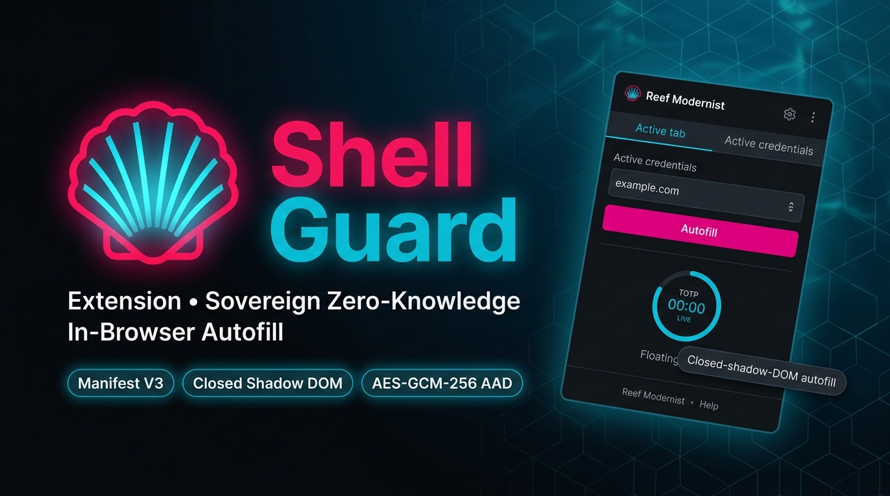

# 🐚 ShellGuard-Extension

  

  <strong>Zero-knowledge Chromium extension (Manifest V3) for the self-hosted <a href="https://github.com/ClawStackStudios/ShellGuard">ShellGuard</a> ecosystem.</strong> 
  <em>Client-decrypted autofill, micro-TOTP generation, and agentic vault delegation without third-party cloud trust.</em>

  
  
  
  

---

## 💎 Overview

**ShellGuard-Extension** brings the sovereign security of your self-hosted ShellGuard vault directly into Chromium browsers (Chrome, Brave, Edge). Engineered under an untrusted browser execution model, it decouples memory-safe WebCrypto key derivation from web pages, providing instant credential autofill while guaranteeing zero plaintext exposure.

- **Zero Third-Party Cloud**: Connects strictly to your sovereign self-hosted ShellGuard server.
- **Client-Decrypted Autofill**: Vault secrets are decrypted in memory using client-derived master keys (`hu-` / `lb-`). The server and host never observe plaintext.
- **Closed Shadow DOM Overlay**: In-page autofill badges render inside closed Shadow roots (`attachShadow({ mode: 'closed' })`), completely isolated from webpage JavaScript inspection.
- **Micro-TOTP Engine**: RFC 6238 authenticator tokens generate dynamically with live SVG countdown rings, auto-copying to clipboard during multi-step logins.
- **Agentic Delegation**: First-class support for autonomous AI agents operating under scoped LobsterKeys (`lb-`) with structural permissions (`canRead`, `canWrite`).

---

## 🏛️ Ecosystem Architecture

ShellGuard-Extension operates as the browser arm of the unified ShellGuard ecosystem:

| Component | Role | Target Platform | Repository |
| :--- | :--- | :--- | :--- |
| **[ShellGuard Web & Server](https://github.com/ClawStackStudios/ShellGuard)** | Master encrypted secrets vault, multi-tenant DB & SuperLobster TLS hub | Node.js / SQLite / Web | `ClawStackStudios/ShellGuard` |
| **[ShellGuard-Mobile](https://github.com/ClawStackStudios/ShellGuard-Mobile)** | Sovereign mobile password manager with Android system autofill service | Android (Jetpack Compose) | `ClawStackStudios/ShellGuard-Mobile` |
| **[ShellGuard-TOTP](https://github.com/ClawStackStudios/ShellGuard-TOTP)** | Offline-first standalone authenticator companion with biometric gates | Android (Jetpack Compose) | `ClawStackStudios/ShellGuard-TOTP` |
| **ShellGuard-Extension** (This Repo) | Zero-knowledge in-browser autofill, active tab matching & credential injection | Chromium Browsers (MV3) | `ClawStackStudios/ShellGuard-Extension` |

---

## 🎨 Reef Modernist UI Architecture

The extension implements the **Reef Modernist ("Bioluminescent Defense")** design language, calibrated for high-density, context-aware browser workflows:

- **Abyssal Dark Canvas**: `#0F1419` base canvas with `#171C21` carapace card containers.
- **Carapace Ridges**: Crisp 1px `#3D484E` tactile borders with 12px structural radii.
- **Bioluminescent Signaling**: **Lobster Red (`#E4048A`)** for primary execution triggers and **Claw Cyan (`#06B6D4`)** for active telemetry and focus rings.
- **Active Tab Priority**: Opens automatically to matching logins for the current browser domain with one-click autofill.
- **Eye-beside-Copy Invariant**: Secret unmask toggles (`Eye`) are positioned directly to the **left** of the copy action for ergonomic safety.
- **LAN Transport Pill**: Prominently warns with an amber badge (`⚠️ HTTP LAN`) when communicating over local unencrypted RFC 1918 / Tailscale networks.

---

## 🔒 Zero-Knowledge Security Invariants

1. **Client Derivation Only**: Master keys (`hu-`, `lb-`) never touch disk cleartext, persistent local storage, or server payloads.
2. **Strict DOM Isolation**: Content scripts never hold cryptographic keys or raw vault state; all crypto operations execute in isolated background/offscreen contexts.
3. **Record-Bound AAD**: Encryption uses AES-GCM-256 with Additional Authenticated Data bound to the record UUID and namespace ($\text{AAD} = \text{uuid} \parallel \text{ns}$).
4. **Volatile Session Zeroization**: Decrypted session caches zeroize immediately upon lock timeout or manual vault lock.
5. **Closed Shadow DOM Autofill**: Page-level form attachments render in `attachShadow({ mode: 'closed' })` to prevent DOM XSS credential harvesting.

---

## 📚 Technical Documentation

- **System Architecture**: [`ARCHITECTURE.md`](ARCHITECTURE.md) — Three-zone security model, directory layout, and data flow.
- **Security Policy & Threat Model**: [`SECURITY.md`](SECURITY.md) — Attack scenarios, non-extractable key quarantine, and disclosure policy.
- **UI & Design System**: [`DESIGN.md`](DESIGN.md) — Reef Modernist styling tokens, components, and layout contracts.
- **Project Law & Rules**: [`AGENTS.md`](AGENTS.md) — Compressed immutable rules, invariants, and navigation schema.
- **Changelog**: [`CHANGELOG.md`](CHANGELOG.md) — Monotonic versioning and release chronicle.
